# The Jetta Manual

For the people who work tickets. Ten chapters, in the order you'll meet them.

Jetta is our AI support agent. Every incoming Freshdesk ticket runs through it: it reads the ticket, searches the knowledge base, checks the customer's account and the dev board, works out which of our apps the ticket is about, and writes a suggested reply.

The console lives at **https://jettajetpack.vercel.app**.

> **The one rule.** On Freshdesk, Jetta sends the **first reply** on a ticket herself, a few minutes after writing it, when the ticket came in directly (email, portal or the in-app form) and nobody has answered yet. Every reply after that waits for a human to send it. Live chat is the other exception: there Jetta replies to visitors directly, with nobody reading first. Almost everything else in this manual follows from those sentences.

---

## 1. What Jetta actually does

A ticket arrives. Jetta reads it, retrieves what it knows, and writes a reply. If it is the first reply on a direct ticket and passes a second check, Jetta sends it to the customer herself a few minutes later (chapter 4, *The first reply*). Otherwise she posts that reply as a **private note on the ticket**. Customers never see private notes. You copy it, change what you want, and send it as yourself.

That means there is no queue to clear and no console step in the critical path. If you never opened the console again, tickets would still get answered, because the suggestion is sitting on the ticket where you already work.

**Not every ticket gets a suggestion.** Out-of-office replies, bounces, marketing and spam are filtered out before Jetta runs. A ticket with no private note on it is usually one Jetta was never meant to answer — not a failure.

**Live chat is different, and that difference matters.** In the website widget Jetta is the front line: it answers visitors live, unreviewed. Chapter 5 is about the review that happens afterwards instead.

---

## 2. Signing in

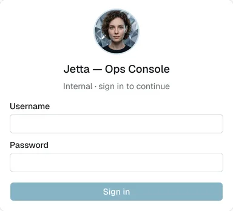

Use your own username — every decision you make is recorded under your name. Sessions last seven days.

If you're an admin, you'll see a **View as general** control in the header. It's a real downgrade, not a preview: while it's on, you get exactly the surfaces a general user gets.

---

## 3. Your morning: the Today page

Start here. One screen for the overnight read: what came in, what's spiking, and what needs a person.

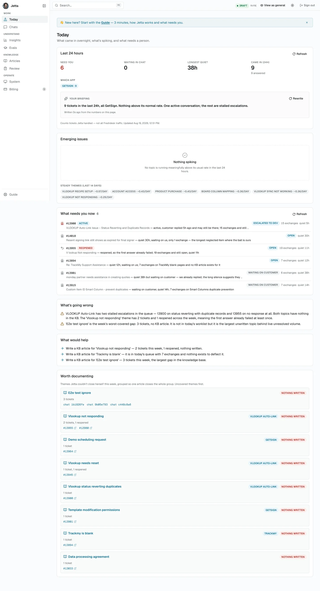

Every number on this page counts **tickets Jetta handled** — not all Freshdesk traffic.

### Last 24 hours

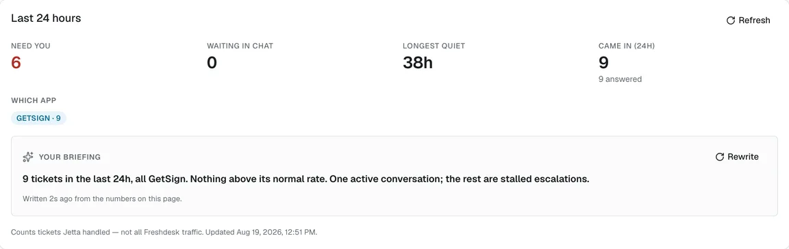

Four tiles — **Need you**, **Waiting in chat**, **Longest quiet**, **Came in (24h)** — then a breakdown of which app the volume landed on.

**Your briefing** sits inside this card: a short written read of the numbers on the page, regenerated when they change. It's commentary, not data — the tiles and lists below are the source of truth. **Rewrite** forces a fresh one.

### Emerging issues

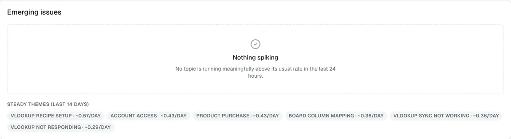

A topic has to clear two bars to appear here: at least **3 tickets in 24 hours** *and* **3× its daily average** over the previous 14 days. An ordinary busy day doesn't cry wolf.

Each issue shows which app it hit and whether the knowledge base already covers it. The distinction is the useful part:

- **in KB** — an answer exists and customers aren't finding it. That's a findability problem.
- **no KB article** — nothing is written. That's a writing job.

When nothing is spiking you get **Steady themes** instead: the normal background rate, so you can see what routine looks like.

### What needs you now

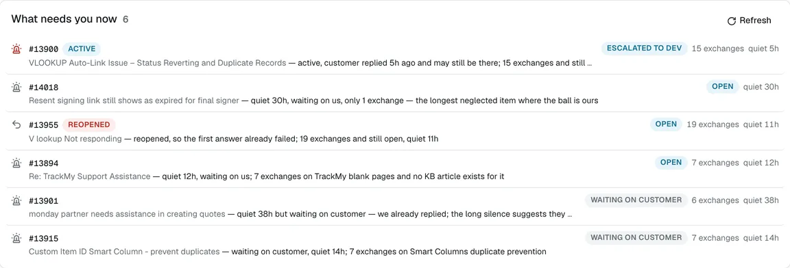

The work on this page that is actually yours. Each row carries a state, how many exchanges have happened, and how long it's been quiet:

| State | What it means |
|---|---|
| **Needs your reply** | The last message on the ticket is the customer's. Someone owes them an answer. |
| **Active** | The customer replied recently and may still be there. |
| **Open** | Waiting on us. The ball is ours. |
| **Reopened** | Jetta's answer didn't land and the customer came back. |
| **Waiting on customer** | We've replied. A long silence here may just mean they dropped it. |

**Reopened is the highest-signal item on the page.** It means the first answer already failed once.

**Needs your reply** is read from the thread, not from the status someone set. So a row can say *needs your reply* and *waiting on customer* at once — that means the customer wrote back and nobody moved the status. Believe the thread.

### What's going wrong, and what would help

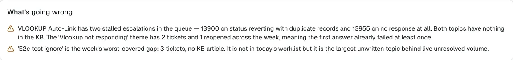

A written read of the patterns behind the queue — which topics have stalled escalations, which have nothing in the knowledge base, which themes have already failed an answer.

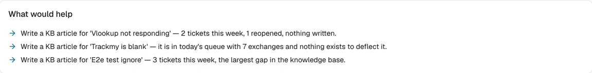

The same analysis turned into specific jobs, usually "write this article, because it has *this* many tickets and nothing written."

### Worth documenting

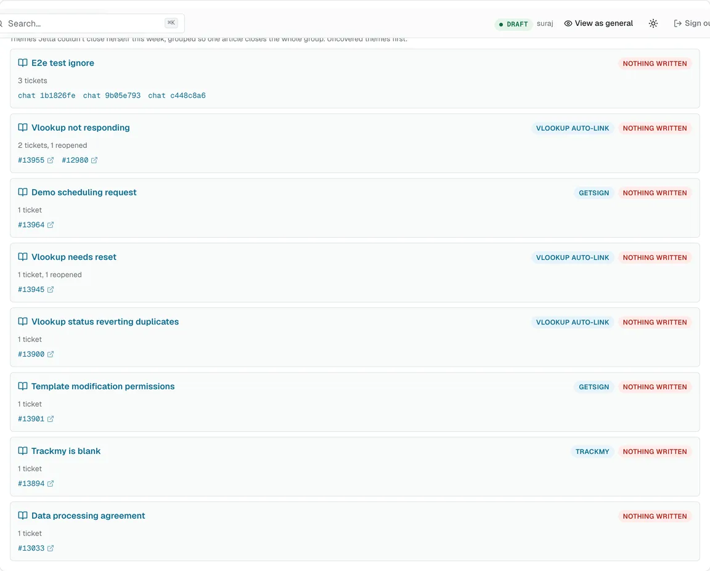

The week's unresolved tickets grouped **by theme**, worst-covered first, so one article closes a whole group rather than a single ticket. Each group lists the tickets and chats behind it.

---

## 4. Replying to a ticket

This is the whole job, and it happens in Freshdesk — not here.

Open the ticket. Jetta's suggestion is in a private note. Copy it into the reply editor, change whatever you want, send as yourself. That's it.

### The first reply: Jetta sends it

Since 2026-10-12, Jetta answers the **first message** on a ticket herself, so customers aren't waiting hours for a first response. This is on in production (`JETTA_FIRST_RESPONSE=on`; /system shows the live state).

- **Which tickets:** ones the customer opened directly: email, the support portal, the in-app support form (Freshdesk calls it "phone") and the Freshdesk widget. **Never tickets that came from a chat** (JettaChat or Freshchat hand-offs), and never once anyone has replied publicly.
- **How:** Jetta writes the reply, a second model checks it (no invented promises, refunds, dates or fixes, no internal details), and if it passes she posts a private note saying when it will go out. **3 to 7 minutes later** she re-reads the ticket and sends it.
- **How to stop one:** reply first yourself, add the tag `jetta-hold`, or close the ticket.
- **If the customer writes again before it goes,** it is cancelled, and a private note says so: "Jetta did NOT send the first response announced above". Nothing has reached the customer at that point, so use the text as a draft if it still fits. An out-of-office auto-reply from the customer does not count as writing again; the reply still goes.
- **If Freshdesk can't be reached at send time,** she tries again every minute. After an hour she gives up and leaves a note asking a person to send it. A note saying a reply is on its way is always followed by the reply or by a note saying it was not sent.
- **When the check fails** (or it's a call/demo request or a price negotiation), nothing is sent: you get the normal private-note suggestion, with a banner saying it was held for a person.
- **Everything after the first reply** is a suggestion in a private note, exactly as described below.

<div class="placeholder">Screenshot needed: Jetta's suggestion as a private note on a Freshdesk ticket.</div>

**Writing the reply *is* the feedback.** Jetta reads back what you actually sent, compares it against what it suggested, and records the difference on its own — sent as-is, edited, or replaced entirely. You never have to tell it anything, and there is no button to press. This is the single most important thing to understand about the whole system: chapter 7 exists because of this paragraph.

<div class="placeholder">Screenshot needed: the reply editor with an edited version of Jetta's suggestion.</div>

Two behaviours worth knowing:

- If the customer writes again while a suggestion is waiting, the old one is marked **superseded** and Jetta writes a fresh one against the new message.
- If nobody ever replies, the suggestion quietly **expires** after two weeks instead of piling up. An expired suggestion is not a black mark against anyone.

### When the customer goes quiet

When a customer goes quiet after our reply, Jetta follows up in her own name (`JETTA_TICKET_FOLLOWUP`; the cron runs every 20 minutes and only reports unless the switch is on).

- **Three touches.** A check-in after 2 business days, a nudge 3 business days after that, and 3 more later a closing message, after which she sets the ticket to **Resolved**. Each is written from the thread, not from a template, and goes out around the hour the customer last wrote.
- **You see each one first.** Every touch sits on the ticket as a private note for about an hour before it is sent. Reply to the customer yourself, or add the tag `jetta-hold`, and it is cancelled.
- **A colleague's reply restarts the count** from that reply. If the colleague told the customer the ticket is closed, she stops there.
- **A customer's reply ends it.** The ticket is theirs to be answered, and she writes a suggestion as usual.
- **One follow-up per customer.** Someone with two tickets about the same problem is followed up on the one we answered most recently.
- **Never on** outbound tickets, internal ones, or `[TEST]` tickets.

She only closes a ticket that is actually waiting on the customer:

- **Only Open, Pending or Waiting on Customer.** Escalated to Dev, Working on it, HOLD, Validating, Customer responded: all mean the next move is ours, so the ticket is left alone.
- **Never while an escalation is open.** If Jetta escalated the ticket to the team, it is not closed automatically, whatever the status says.
- **Never while the dev board still has it.** Before any touch, Jetta looks up the dev items filed for that ticket on both boards. If one is still in flight there is no follow-up at all, with one exception: when engineering has parked the item on **Waiting Customer**, she checks in and nudges, but still never closes. "In flight" means anything in a live group — ToDo, Working on it, Waiting Customer, HOLD, Testing Failed, even Done until it is moved or marked Deployed to Prod. Only the Done / Deployed To Prod groups, or a status of Deployed to Prod, Archived, Not an Issue, Not Bug or Could not Replicate, count as finished. If monday can't be read, the ticket is held and looked at again on the next run. A dev item stays tied to its ticket however long its thread gets.
- **An escalation is never a resolution.** A turn where Jetta escalated or filed a dev item is the customer waiting on us.

Two things that used to go wrong and no longer do. If two runs overlap, the customer still gets each touch once. And if the closing message goes out but Freshdesk refuses the status change, the next run finishes the close instead of leaving the ticket open (`ticket_followup.resolved_late` in the event log).

When the customer does reply on a ticket that has a dev item, Jetta sees that item and its Dev Status in her context (not just fuzzy matches by subject), reads engineering's comments on it before answering, and treats the issue as unresolved while the item is in flight: she won't close the ticket, won't tag the turn as a resolution, and won't file a second item for the same problem. If the item is finished but the customer says it still happens, that goes back to engineering as new information.

If the customer replies to a closed ticket, Jetta picks it up and writes a suggestion even if Freshdesk hasn't reopened the ticket yet. A separate daily check at 09:00 UTC catches a customer reply that never got a suggestion, on tickets where a resolution had been sent.

### Compliance and security paperwork goes to Mark

Security or vendor questionnaires (a spreadsheet, or a OneTrust or Whistic link), DPAs, BAAs, NDAs and other agreements to sign, SOC 2 reports, pen tests, insurance certificates, and compliance or privacy questions asked as part of a review all go to **Mark Shaw** (external compliance) on the **Security Questionnaires** monday board, not to the dev board and not to engineering. On a ticket, Jetta files the item on the first turn (`send_to_compliance`), assigned to Mark, with the customer's files attached and a summary he can work from without opening the ticket. One item per ticket: a later turn adds to it. She tells the customer the compliance team has it and will reply on the ticket, and asks for a deadline if a questionnaire came without one. She never fills in a form, says whether we will sign something, confirms a certification, or gives a turnaround. For GetSign she may point to the Trust Center as general reading. The ticket stays open while Mark has it: quiet-customer follow-ups won't close it. In chat she can't file it, so she opens a ticket and asks the customer to send the documents by email.

### Jetta and the dev board, both ways

Jetta doesn't only file dev items; she keeps talking to the developers on them, and passes what they say back to the customer. Four parts, each with its own switch on **System → Dev bridge**: **off**, **shadow** (she works out what she would do and logs it as a `devbridge.*` event, but posts nothing), or **on**. Check System for which are live; this section describes what each does when on.

- **Developers → customer** (`JETTA_DEV_BRIDGE`). When a developer comments on the dev item filed for a ticket, or moves its Dev Status, Jetta reads the ticket and acts:
  - A question or **Need more info / Waiting Customer / Missing Info**: she answers on the item from the ticket, or asks the customer and says on the item what she asked.
  - A workaround, or **Deployed to Prod / Test passed on prod**: she tells the customer the fix is out and asks them to try again.
  - **Not an Issue / Could not Replicate**: she explains if the thread does, or asks the customer for exact steps.
  - Developers talking to each other, progress notes, other statuses: she does nothing.
  - While replies are on **draft**, what she writes for the customer here is a suggested reply on the ticket, not a sent one. She says exactly that on the item ("I have drafted a reply to the customer; it goes out once a colleague in support approves it") and in her note, never "I have replied". If you see that on an item, the customer has heard nothing until someone approves the draft.
  
  Customer replies from this still follow the normal rules (a suggestion you send, outside her first reply).
- **Customer → developers** (`JETTA_DEV_RELAY`). When a customer writes on a ticket that has an open dev item, Jetta puts anything the developers can use on the item: details, error text, answers, files. If a developer asked for something inside a thread, the customer's answer goes back into that same thread, with an @mention for whoever asked. When the customer explicitly asks for an update and nothing has moved, she asks the developer, once per silence, as a new comment so it is seen. When a customer asks how something works and the KB has no answer, she files it as a **Type = Question** item instead of guessing (`ask_devs`), and tells the customer she's checking with the team.
- **Follow-up on quiet dev items** (`JETTA_DEV_FOLLOWUP`, daily). If a ticket is still open and its item has had no comment and no status change for 3 working days (Saturday off), Jetta asks the Developer for an update; 3 working days later she asks again; then she raises it once in the escalation channel and stops. A comment from engineering or a status change resets it. A comment from the item's Reporter or from the support team ("any update?") counts as another ask, not as progress, whoever the engineer answering is: they do not need to be the one in the Developer column. One item that fails does not stop the rest of the run. She leaves alone items set to Waiting Customer or Need more info, on hold, finished, or feature requests.
- **Follow-up on items with no ticket link** (`JETTA_DEV_FOLLOWUP_UNLINKED`, same cron). Items filed by hand often name the customer in the title instead of linking the Freshdesk ticket. When a Reporter filed one, Jetta follows it up on the same rhythm: she asks the Developer; if the item is Waiting Customer she asks the Reporter whether the customer replied; if it has no Developer she asks the Reporter who should own it. She skips the Internal Bug group, feature requests, and anything quiet for over 60 working days.
- **KB drafts from developers** (`JETTA_DEV_KB`). When a developer answers a Question item, the question and answer are drafted into the KB review queue. When a bug reaches Deployed to Prod or Not an Issue, Jetta asks its Developer once for a short explanation or a doc (PDF, Word or text, posted as a new update) and drafts an article from it. "no KB" ends that. Nothing is published without review. While that request is open, a developer's comment on the item still reaches the ticket in the usual way.
- **Shipped fixes** (`JETTA_RELEASE_WATCH`, hourly; its row is under Capabilities on System). The GetSign team ships to production about once a week. Jetta reads each release on GitHub and, when a fix in it looks like the fix for an open GetSign dev item, comments on that item: which release, which fix, and a request to set Dev Status to **Deployed to Prod** if it is the one. That is all she does. She does not change the status and she does not tell the customer; when the developer sets the status, **Developers → customer** above takes over. If the fix is not for that item the developer ignores the comment. She asks once per item per fix, at most ten times per release, and only about GetSign. A pull request that links the monday item is matched exactly; the rest are matched by what the fix and the item say, which can be wrong, and that is why a developer confirms. She comments when the item is linked or when she is confident it is the same problem; when it is only likely, she comments only if a customer is waiting on the item, and she never comments on shared words alone. In shadow she logs `release.*_shadow` events and posts nothing.
- **Already fixed?** (`JETTA_FIX_LOOKUP`; its row is under Capabilities on System). Jetta remembers the fixes the GetSign developers have made over the last four months, from GitHub: the ones in production and the ones merged and waiting for the next release. When a GetSign ticket arrives she checks it against them. If one looks like the customer's problem you get a private note on the ticket, separate from her suggested reply, headed "recent changes that may be about this ticket": what was fixed, whether it is **in production** or **not yet released**, why she thinks it is related, and the link. **Her reply was written without this, and the customer has not been told.** What to do with it is yours. A fix that was already in production when the customer wrote did not stop their problem, so do not ask them to simply try again: it may not cover their case, or it may have caused it, and the developers should see the link. A fix not yet released ships with the next release, and you do not give the customer a date. A fix that shipped in the last 14 days is flagged too, because a problem that started around then may have been caused by that change. When she files a dev item for the ticket, the same changes go on the item for the developer, marked as a lead and not a diagnosis. Most tickets match nothing and get no note. A match can be wrong; it is found from what the ticket and the fix say. One note per ticket per fix. GetSign tickets only, not chat. In shadow she logs `fixlookup.shadow` events and writes nothing.
- **Repeat problems** (`JETTA_REPEAT_PROBLEMS`; its row is under Capabilities on System). Each ticket used to be handled alone, so when four customers hit the same bug the developers saw four separate reports, or none of the pattern at all. Now, when a GetSign ticket reports something broken, Jetta states the problem in one sentence (quoting any error message), compares that with the problems in the tickets of the last 30 days, and groups the ones that are the same malfunction: the same screen or feature failing in the same way, even when two customers word it differently. A how-to question, a billing question or a feature request is never grouped. Nothing happens at one or two customers. **At three different customers, or two when one of them wrote in after a fix for it was already in production, she tells the developers once** (one person's second ticket about the same thing does not count twice): a comment on one dev item, @Developer, listing every ticket with its date and link, and saying so when a fix did not hold. She uses the dev item one of those tickets already has; failing that, an item on the board that is clearly the same thing; failing that, she files one titled **[Repeat problem] …** (at most two a day). After that each new ticket about it adds one line to the same item. On each of those tickets you get a private note, separate from her suggested reply: the other tickets, and the dev item. **Her reply was written without this, and the customer has not been told. Do not tell a customer how many others are affected.** If she files a dev item for a ticket whose problem already has one, the report goes onto that item and no second item is made. The grouping is her reading of what the tickets say and can be wrong; her comment asks the developers to check, and if a ticket does not belong, tell the developers on the item. When the shared item ships, only the item's first ticket is told automatically for now; the note is how you know which other customers to update. In shadow she groups and logs `problems.shadow` events, and writes nothing to monday or Freshdesk.

**How it looks on monday.** Jetta posts with **Suraj's monday account**, because that is the token she has, so every post of hers starts with **🤖 Jetta:**. She @mentions whoever is in the item's **Developer** column, plus whoever asked when she is answering inside a thread. When there is nobody to mention she still posts, and her own record of the run says nobody was notified. She never changes Dev Status or any other column. That stays the developers' call. Developers can reply in the thread, or set Need more info, and she will pick it up.

**When writes are off.** With `MONDAY_ALLOW_WRITES` off, or monday not connected, she files and posts nothing, knows that she didn't, and hands the ticket to a person through Slack. She does not tell the customer the team has it.

**Safety rails.** A run a developer starts never files another item or closes the ticket. Jetta ignores her own posts, so she can't answer herself, and she runs at most six times per item per day. Never quoting engineers, naming them or giving dates to the customer still applies in full.

These rules exist because of tickets 14453 and 14404, where escalated customers were told their issue was assumed resolved.

### The audit trail

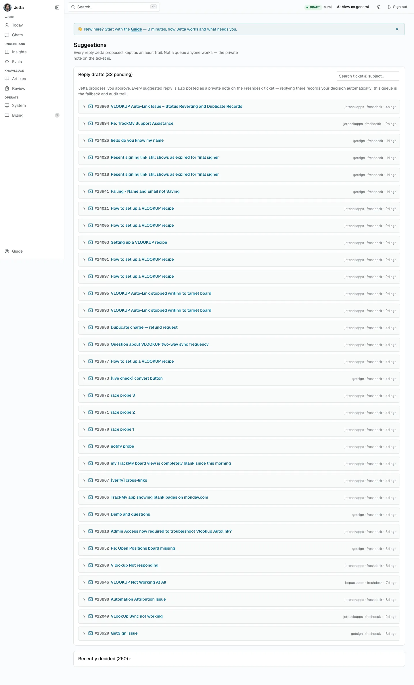

Every suggestion Jetta has ever proposed is kept at `/drafts`. It shows a pending count, and that count will look alarming — it is not a backlog. **Nobody works this queue.** The private note on the ticket is the real surface; this is the paper trail for when you need to ask "what did it say, and when?"

That's also why `/drafts` isn't in the navigation.

---

## 5. Live chat: where Jetta answers alone

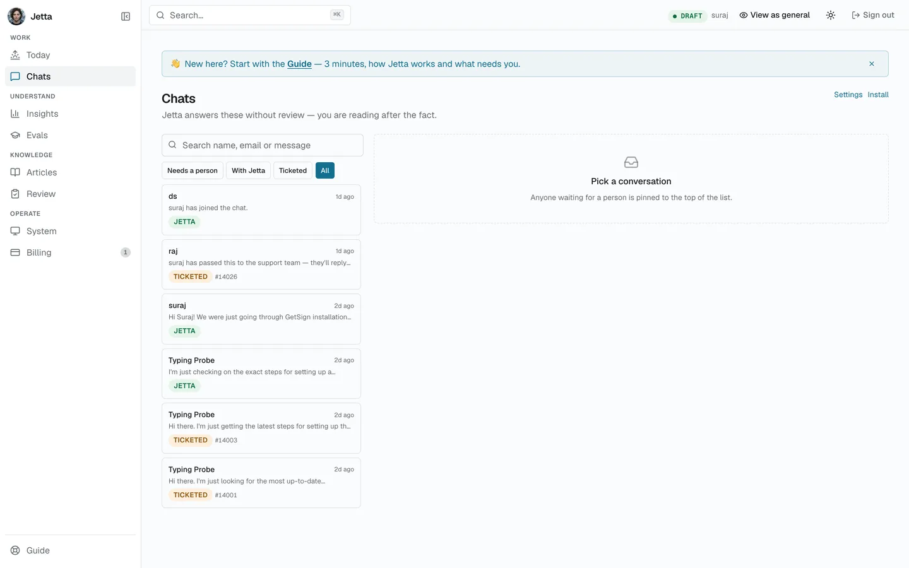

In the website widget, Jetta replies to visitors live with nobody reading first. This page is the compensating control for that. Skim the transcripts, reading for three things: a wrong fact, a confident answer to something that should have been escalated, or a tone we wouldn't use.

The filters across the top are **Needs a person**, **With Jetta**, **Ticketed**, **All live** and **Resolved**. "All live" is everything still going; a finished conversation moves to Resolved and out of the working view.

### Reading and taking over a conversation

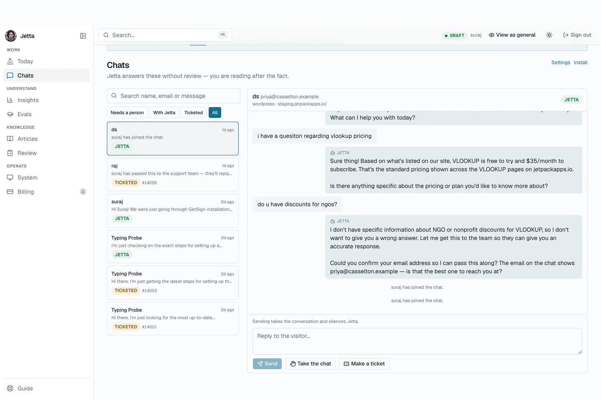

Pick a conversation and the transcript opens beside the list. Three controls matter:

- **Take the chat** — you join the conversation. From then on you're typing to the visitor yourself and Jetta stops answering. Sending a message takes the conversation and silences Jetta, so don't type a note to yourself in there.
- **Make a ticket** — opens a Freshdesk ticket carrying the whole transcript. The conversation becomes **Ticketed** and the two point at each other, so neither side is a dead end.
- **Resolve** — files the conversation under **Resolved** and out of the live list. The visitor is told nothing and nothing is deleted; the transcript stays here for the retention window. **Reopen** takes its place if you change your mind, and a new message from the visitor reopens it by itself.

A visitor who asks for a person moves to **Needs a person**, pins to the top, and pings Slack. The visitor always sees who is speaking, so a handover is never silent. If nobody takes the chat within a minute, Slack is pinged again (a louder second call) and the visitor sees "Still trying to find someone". If nobody takes it after that, Jetta **opens a Freshdesk ticket** with the transcript, tells the visitor the ticket number and that the team will email them, and posts the ticket link in Slack so nobody jumps into the chat late. Both the wait and the number of calls are in chat settings. A visitor who never gave an email can't get a ticket, so Jetta takes the chat back herself. She doesn't ask for a person a second time that day. A handoff left unanswered for over two hours is ended quietly, without a message, and shows under **With Jetta**.

Jetta opens tickets herself when she can't resolve something — the button is for when you decide before she does.

### What a visitor can and can't get in chat

Anyone can open the widget and type anything, so chat is treated as anonymous until something proves otherwise.

- **Billing.** Jetta does not look up or change a FastSpring account from chat: an email typed into a chat is not proof of who is typing. She opens a ticket, and the team answers by email, where the reply lands in the account owner's inbox.
- **The monday account.** Inside our apps the widget can pass monday's signed session token. With it, Jetta knows the account for certain: she uses it for trial and discount requests without asking, and can see earlier tickets from that account ("did my template get fixed?"). Without it, including an app view that sends no token, the account is only a claim. She confirms it with the visitor before a trial or discount request and does not look up the account's other tickets. The token is checked when a chat is opened and again each time a saved chat is picked back up, so a chat that began unconfirmed becomes confirmed once the app passes a token for the same account. A token for a different account changes nothing.
- **Limits.** One network can open 40 new chats an hour. One email address gets 3 chat tickets a day. Across the whole channel there are 30 chat tickets and 20 "ask the team to join" pings an hour. Real use is nowhere near these; when one is hit, Jetta says honestly that she couldn't open a ticket, and `chat.ticket_capped` or `chat.handoff_capped` appears in the event log. A ticket you open with **Make a ticket** is not counted.
- **She says what happened.** If a ticket could not be opened, or nobody could be asked to join, the visitor is not told otherwise.

**Their own GetSign setup** (`JETTA_APP_STATE`; its row is under Capabilities on System). When someone chats from inside the GetSign app and monday has vouched for their account in the last 24 hours, Jetta knows that account's setup: the plan and what it includes, usage against its limits, the account settings, the workflows on the board they have open (which column the signer's email is read from, auto-send, reminders, link expiry, attached templates), how many signing sessions are waiting or done, and failures on record. She uses it to answer: "Signing order isn't part of your current plan", "your Contracts workflow has no column mapped for the signer's email". **She does not tell the customer she looked**, and she does not ask permission; she states it as something she knows. She still needs a knowledge base article for how the product works and for the steps to change anything, so a fact about their setup with no article for the fix ends in a question or a ticket, as before. She never sees signer names or emails, documents, links, or anything from another account, and she cannot change anything. Everyone else, a website visitor above all, gets no lookup: a typed email proves nothing, so she asks for the detail she needs and may suggest opening the chat from inside GetSign. If the lookup fails she carries on as if she had none. In shadow she reads and logs what she would have been shown (`appstate.shadow`) and her answers are unchanged.

### Chats that finish themselves

Most chats end with the visitor simply not replying. Jetta closes those herself: about **15 minutes** after her answer she checks in once, and if nobody has come back **24 hours** later she marks the conversation **Resolved**. If the transcript already says it was sorted — "perfect, thanks" — she skips the check-in and resolves it there and then.

Four things she will never do, so you can trust the bucket:

- speak in a conversation a colleague has taken, or one where a visitor is waiting for a person;
- check in when the visitor spoke last — that means *she* owes the reply, and it stays under **With Jetta** for someone to look at;
- check in on a **Ticketed** chat, where a colleague is answering by email — those resolve quietly, and the ticket is untouched;
- check in twice.

Resolved by **jetta** in the transcript header means she made the call; your name means you did.


---

## 6. Asking Jetta in Slack

Jetta answers direct messages and questions in the agent panel. It is **read-only there by construction**: it can look things up and explain them, but it cannot change anything from a DM. That makes it a safe Freshdesk stand-in for people who don't have a Freshdesk login.

<div class="placeholder">Screenshot needed: a DM conversation with Jetta answering a lookup question.</div>

Escalations land in **#jetta-escalations**. When Jetta posts there, it's because it decided a person was needed — treat the channel as a worklist, not a feed.

<div class="placeholder">Screenshot needed: an escalation post in #jetta-escalations.</div>

### Talking to Jetta in the console

Admins, and anyone Suraj has given access (`CONSOLE_ASSISTANT_USERS`), can also talk to Jetta **by voice, inside the console**. Press **⌘J**, click the round button at the bottom right, or choose **Ask Jetta** in ⌘K. Ask out loud or type in the box. It knows this manual, the live configuration on System, and which page you are on. It can look up tickets, the knowledge base, customer accounts, the dev board, Today, Support health, Performance, Team activity, chat conversations and their transcripts, billing requests and their history, the ticket follow-up queue and the event log, and it can **take you there** while you keep talking. It goes to the specific thing, not just the page: a section ("what needs me today"), or the list of tickets behind a number on Support health or Performance ("show me the reopened GetSign tickets").
- When it mentions tickets, dev board items or articles, it puts **clickable links** in the panel, and ticket numbers in its answers are links too. It only shows links its lookups actually returned.
- The ticket lists behind numbers have their own links now (`/health?drill=…`), so you can paste one into Slack and it opens the same list.

- It is **read-only**, the same as in Slack. It cannot reply to a customer, change a ticket, approve anything or write to the dev board. Ask it where to do that and it will take you there.
- For "why" questions, and anything that combines several lookups, Jetta **thinks deeper on its own**. It hands the question to a slower reasoning model, answers, then switches back to the quick model. The panel shows "Thinking deeper…" while it works. There is no button for this.
- Talk over it to interrupt, and the mic button mutes you.
- **Minimising stops listening.** The microphone closes, and nothing you say is heard until you reopen the panel. Reopening picks the conversation back up. The red button ends the conversation and clears it.
- Every lookup it makes is logged as `assistant.tool` in the event log, with who asked.

---

## 7. Teaching Jetta: the Evals page


This is the loop that changes how Jetta writes, and the one page that genuinely needs a human. Nothing here applies until someone approves it.

### Draft quality

The top card scores the last 30 days: **Decisions**, **Sent as-is**, **Edited**, **Discarded** — plus the reasons your edits clustered around, tagged things like `product-knowledge-gap`, `conciseness` and `judgment-call`.

Read the tags before the numbers. A high discard rate with `product-knowledge-gap` on most of them is a knowledge base problem, not a writing problem.

### From your replies to a rule

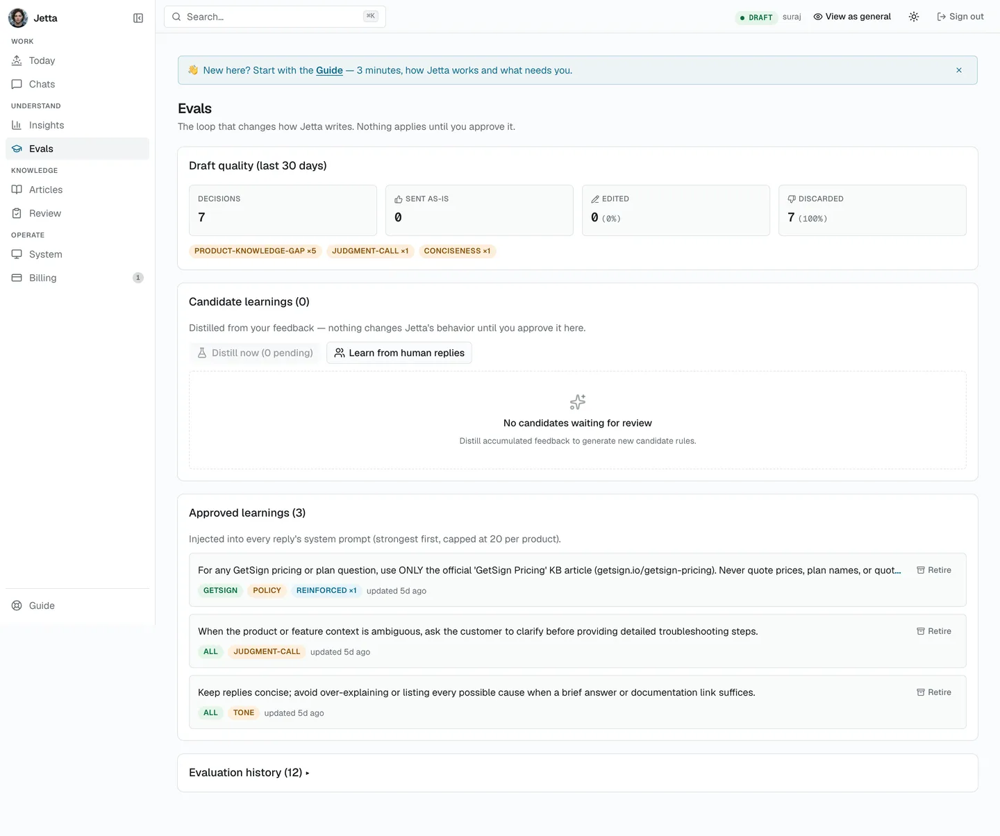

Three steps, in order:

1. **Learn from human replies** — replays recently resolved tickets, compares what Jetta would have written against what you actually sent, and records every meaningful divergence. Your ordinary replies are the training data.
2. **Distill now** — turns accumulated divergences into short candidate rules. Patterns only; a one-off never becomes a rule.
3. **Approve or reject** — nothing changes until you approve. Approved rules are injected into every reply's system prompt from then on, strongest first, capped at 20 per product.

**Approve narrowly.** A rule is permanent instruction until someone **retires** it. Here's a real one, and note how tightly it's scoped:

> For any GetSign pricing or plan question, use ONLY the official 'GetSign Pricing' KB article. Never quote prices, plan names, or quotas from comparison or feature articles — those are stale and conflicting.

That rule exists because a customer was quoted a wrong price. It names one article, one topic, one product.

### Which goes where

The line that saves the most confusion:

| Kind of thing | Where it belongs |
|---|---|
| A **fact** — "the Pro plan is $29" | Knowledge Base |
| A **behaviour** — "ask which board before troubleshooting a sync" | Evals |

---

## 8. The Knowledge Base

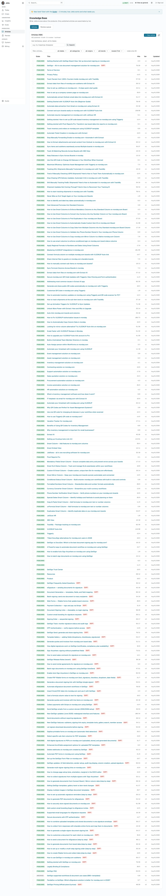

What Jetta knows about the products. Articles move through four states — **draft → in review → published → archived** — and only one of them matters day to day:

**Only published articles are searchable by Jetta.** A perfect draft is invisible to her.

The list shows each article's state, hit count, version, and a **DUP?** flag where two articles look like duplicates. **Test retrieval** is the box to use when you want to know what Jetta would actually find for a given question — it's the fastest way to answer "why did she say that?" about a fact.

The knowledge base syncs daily from our websites, so most articles maintain themselves. The GetSign app reference is the exception: its articles come in through the review queue (below).

**Who can remove an article.** Anyone can delete a draft or something waiting in review. Archiving an article, and deleting one that is published or archived, needs an admin: both take away an answer Jetta relies on, and a delete cannot be undone.

### The review queue

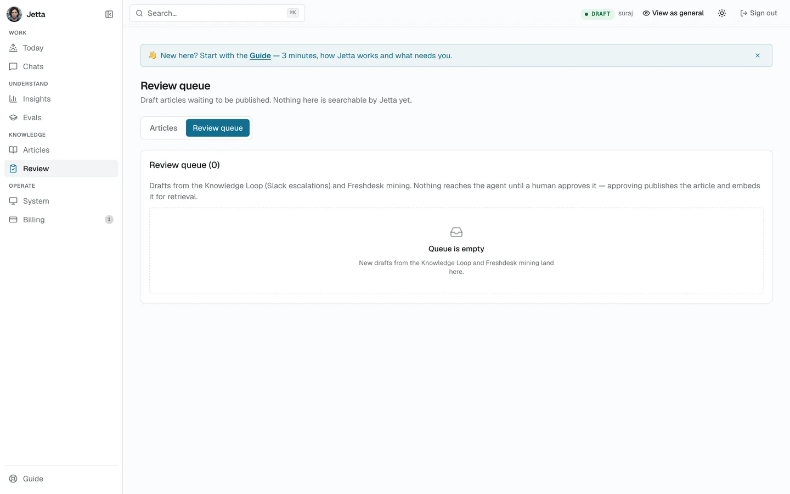

Draft articles waiting to be published, from these sources: the Knowledge Loop (Slack escalations), Freshdesk mining, the Dev board page, the developers themselves (tagged `dev-board`), and the GetSign app reference (tagged `reference`). When a developer answers a Question item, or sends a doc after a fix, Jetta drafts it here; see "Jetta and the dev board, both ways" in chapter 4. Nothing here reaches Jetta yet.

**The GetSign app reference.** The GetSign developers keep a reference of every screen, tab and setting in the app, and the rules behind them (what is required, what is locked on which plan, why a workflow will not save). Jetta has articles written from it, titled "GetSign …", origin **GetSign app reference**. They arrive here as drafts and Jetta cannot use one until somebody publishes it. Two things to check before you do: that the wording is right, and that the screen it describes is live for customers, because the reference follows the app's development branch and can be a release ahead. These articles have no public link, so Jetta answers from them in her own words and gives no link. Every day, with the site sync, Jetta reads the reference again. When the developers have changed a section she redrafts the article written from it, leaving out file names and code names (a redraft that still names one is thrown away and tried again the next day). What happens next depends on who owns the article. A draft nobody has touched is simply updated here. Once you edit or publish an article it is yours and is never overwritten: a **Reference changed: …** notice appears here showing what would change; edit the article if it matters, then mark the notice handled. A new section in the reference becomes a new draft. If a section disappears, an untouched draft is removed and anything a person approved gets a **Reference dropped: …** notice. A draft you reject stays away until its section changes. The daily read needs `JETTA_GETSIGN_REFERENCE_TOKEN` (/system shows whether it is set); without it Jetta only has the copy of the reference shipped with the code.

**Release changed notices.** When the GetSign team ships a change customers can notice, Jetta looks for published GetSign articles about the same area and files a **Release changed: …** notice here for each, naming what shipped with a link to the change. It is a to-do, not content: read the article against the change, edit it if a step, label or rule is no longer true, then mark the notice handled. The match is by topic, so the article is often still right. The article itself is never touched, and Jetta goes on answering from it as written. Controlled by `JETTA_RELEASE_WATCH`; see "Jetta and the dev board, both ways" in chapter 4.

Approving does two things at once — it publishes the article *and* embeds it for retrieval. That's the moment it starts affecting answers. Rejecting deletes the draft, and only ever a draft.

---

## 9. The other pages, briefly

### Billing

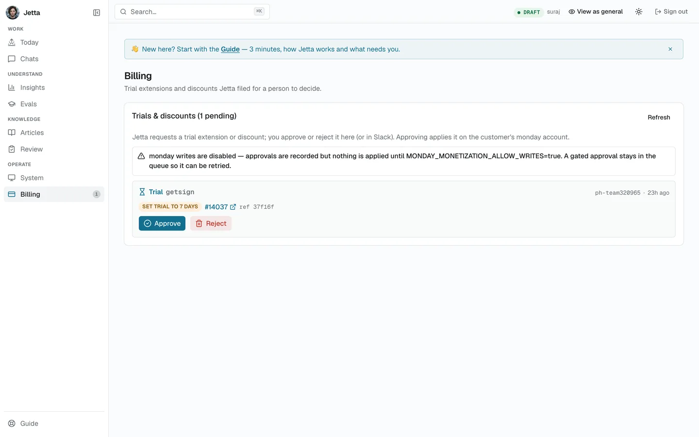

Trial extensions and discounts Jetta won't grant itself, filed for a human. Approve or reject here or in Slack. Pending requests expire after three days, so an ignored one never quietly grants itself. The **History** card below the queue lists past decisions: who approved or rejected what, and when.

### Support health

Team-level support health over the last 28 days: volume, first-reply times against target, who is waiting on a reply, reopens, and which apps and themes drive the load. Every number opens the list of tickets behind it, and those lists have their own links (`/health?drill=…`) you can paste into Slack. **Sync** pulls fresh Freshdesk data, and there is a written AI read of the numbers. Everyone can see this page.

### Performance (admin)

What customers got before and after Jetta went live: reply times, how much of the work was Jetta's, handoffs to people, knowledge gaps worth writing up, and per-agent numbers. Like Support health, every number opens its tickets, and there's a written AI read that cites them.

### Team activity (admin)

What each person did and where: Freshdesk replies, chats, Slack, monday dev items and console actions, as a scorecard and a timeline. It's kept current from Slack and monday as things happen, with an hourly catch-up sync.

**The daily team report.** When a channel is set (`JETTA_TEAM_REPORT_CHANNEL`), Jetta posts this page's previous day to Slack each morning at 03:30 UTC, as two short tables in which every ticket and dev item is a link: a **To do** table (what to do, and the tickets) and a **Team** table with four columns (Name, Freshdesk, monday dev boards, Other), each its own Slack message. If Slack refuses the tables, or the report is too large for one, the same content is posted as plain lines instead. The first line is the team: new tickets, how many were answered and the median first reply, and how many customers are waiting on us (linked to Support health). **To do** follows, only on a day there is something to do, one line per kind: *Reply* (every customer who has waited more than 4 hours, longest first, each a ticket link with the wait), *Reply or close* (waiting over 14 days), and developer updates the customer has not heard about, from the Dev board's client items: *Relay dev update* (developers answered or handed the item back to support), *Dev needs customer info* (the item is set to Waiting Customer or Need more info) and *Fixed, tell customer* (resolved in the last 7 days). A developer update is listed only while its ticket is open and nobody on our side has written to the customer since; each entry links the ticket and the dev item. An item handed back with no ticket Jetta knows of is under *Handed back on dev board*, and handbacks older than 14 days are one counted line linking to Dev board. A memo mark means Jetta's draft is already on that ticket. A line shows the first eight links and then "+N". **Team** is one line per person, in alphabetical order, not ranked: Freshdesk replies and notes with the tickets linked, first replies and how fast, chats taken, activity on both monday dev boards, messages in Jetta's Slack channels and console decisions. Jetta is on that list like anyone else: the replies she sent herself that day (automatic first responses and follow-ups to quiet customers, tickets linked), the drafts she wrote and how the replies that followed used them, the dev items she filed, Slack escalations and chats she turned into tickets. A draft a colleague sent counts as that colleague's reply. What each person did with Jetta's drafts is not shown per person. Someone with nothing recorded that day is left out; names are merged the same way as on this page (`AGENT_ALIASES`), so a shared Freshdesk login or a Slack id with no alias appears under its own name. "The day before" is the calendar day in `JETTA_TEAM_REPORT_TZ` (an IANA zone such as Asia/Kathmandu; unset, it follows `JETTA_TZ`). Mail closed without a reply (booking confirmations, meeting notes) is not a new ticket. Everything is worked out by rule from the Team activity, Performance, Support health and Dev board stores and Jetta's own send events; no model writes it, ticket subjects are not included, and calls, meetings and work done elsewhere are not in it. With no channel set, nothing is posted. An admin can read the exact text for any day, without posting, at `/api/admin/team-report?day=YYYY-MM-DD`; Jetta's own sent replies are only known for the last few days.

### Logs & errors (admin)

What the apps' errors are doing and who they hit, from Sentry and the apps' server logs, checked hourly. **Needs attention** lists errors that are new or spiking and hit customers: the monday accounts, their chat tickets and any dev item that names the error. **By app** shows each app's Sentry errors and log failures with 14-day trends; compare an app with its own usual day. Below are the Slack alerts sent and the dev items filed (or, in shadow mode, the ones it would file). Every number opens what is behind it, and there is an AI read. Sentry "resolved" does not mean fixed, and days Sentry stored nothing (over its quota) are shown as missing, not quiet.

### Test Jetta

The testing playbook: you play the customer, through a guided wizard, to learn how Jetta behaves. Test tickets and dev items are marked `[TEST]`, and the page offers to clean them up when you are done.

### Insights

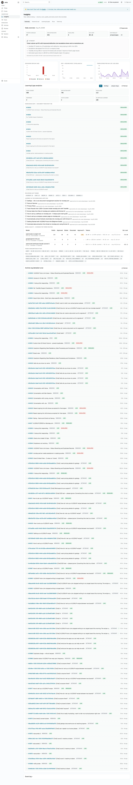

The ops view. **Daily overview** is yesterday's rollup with a written narrative and a **Regenerate** button.

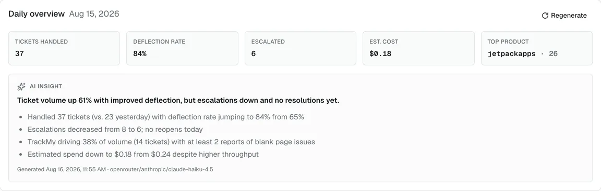

Below it: decisions per day, edit and discard rate, token spend, and per-model quality. Volume is always broken down per app — never as one "Jetpack Apps" lump.

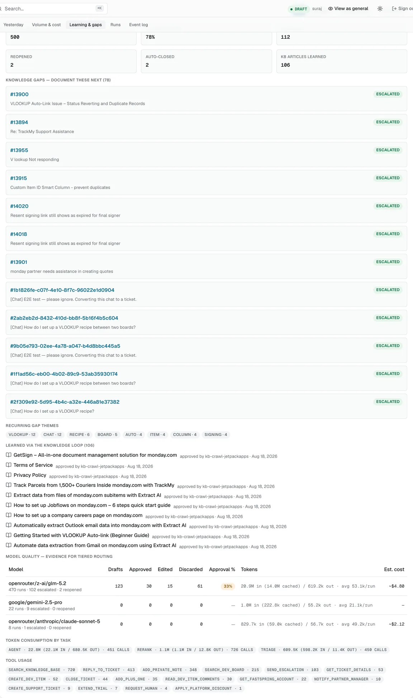

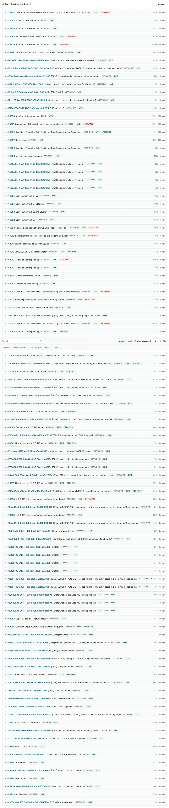

**Activity log** is every run in detail, and the **Event log** below it is the raw stream — where you go when you need to know exactly what happened and when.

### System

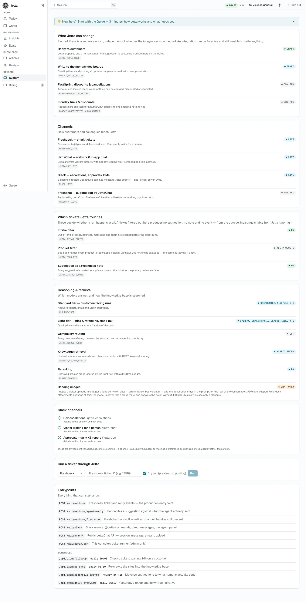

The truth page. Every capability is a separate opt-in, independent of whether the integration is connected — an integration can be fully live and still unable to write anything. It shows whether replies are in draft mode, which channels are live, which tickets Jetta touches, and which models answer.

If you ever want to know whether Jetta *can* do something, this page answers it rather than the docs.

The ticket runner at the bottom previews what Jetta would do on a ticket. Anyone can run it as a **dry run**. Running it live, which posts on the real ticket, needs an admin, and is recorded in the event log with who did it. The event log itself (on Insights) is admin-only, because it holds sign-in attempts.

---

## 10. Ground rules

**Read before you send. You are the last check.** (The one exception is Jetta's own first reply on a direct ticket; see chapter 4. If you want to answer a new ticket yourself, reply first or tag it `jetta-hold`.) Jetta writes confidently whether or not it's right. Check facts, prices, links and account details — especially anything about money.

**If a suggestion is wrong, just write your own reply.** Don't work around it or fix it half-way. That disagreement is exactly what the learning loop feeds on, and a replaced reply teaches more than an edited one.

**Never cancel a subscription** unless the customer has clearly asked for it. No exceptions, no inference from silence.

**If something looks broken** — wrong customer data, a reply about the wrong product, a queue that won't clear — ping Suraj rather than working around it.

---

## Appendix: the chat widget

Two admin pages, included so you know they exist.

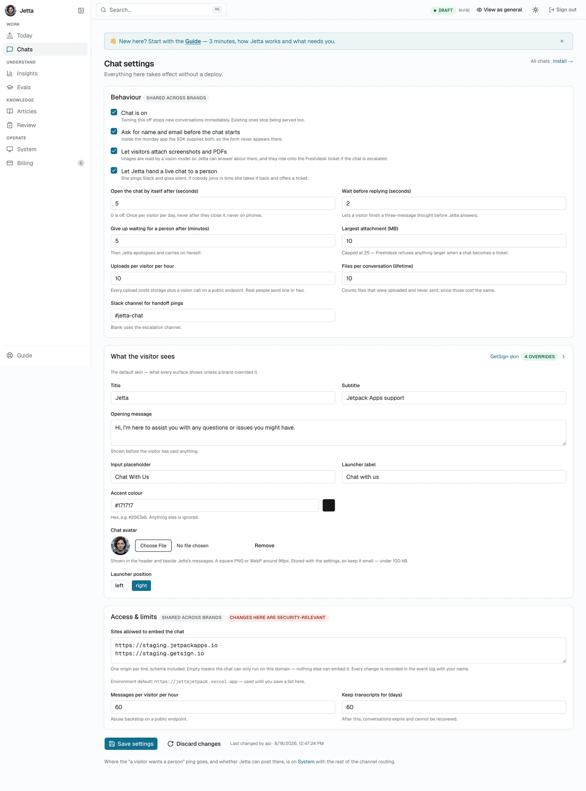

Appearance and limits for the widget. The **Access & limits** section is shared across brands and is security-relevant: the list of origins allowed to embed the chat is what stops anyone else putting our chat on their site. Every change is recorded in the event log with your name.

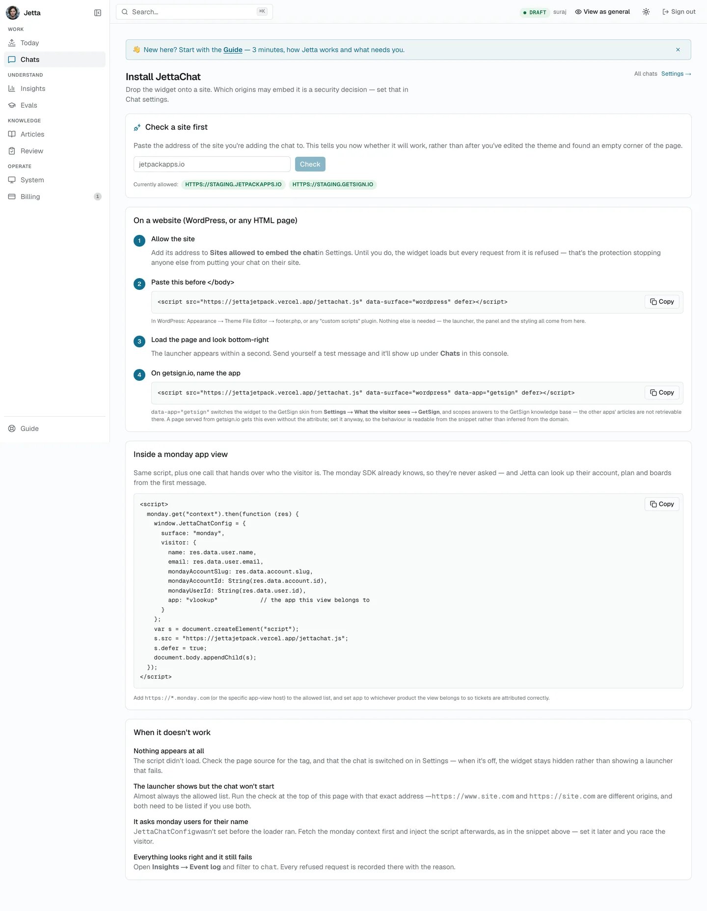

How the widget gets onto a site, including a checker that tells you whether an origin will work *before* you theme it and find an empty corner of the page. The snippets for a monday app view pass monday's session token; an embed without it still works, but Jetta treats the account as unconfirmed (chapter 5).

---

## About this manual

Every screenshot is generated from the live console by `scripts/manual-shots.mjs`, so the manual can be regenerated rather than slowly going out of date:

```
MANUAL_USER=… MANUAL_PASS=… node scripts/manual-shots.mjs
```

The harness refuses to photograph a page showing an error, and swaps real email addresses for a consistent fake cast before each shot. The four gaps marked above are Freshdesk and Slack screens, which it can't reach.
